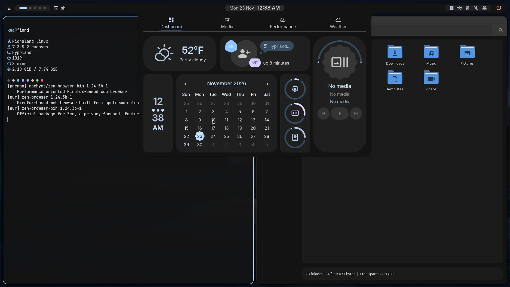
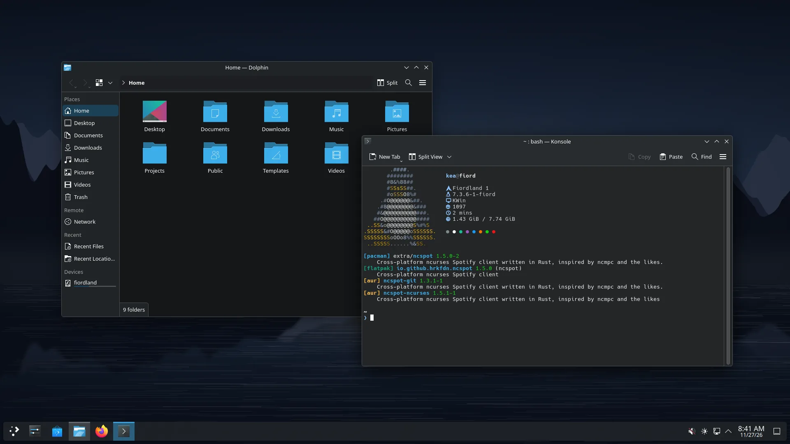
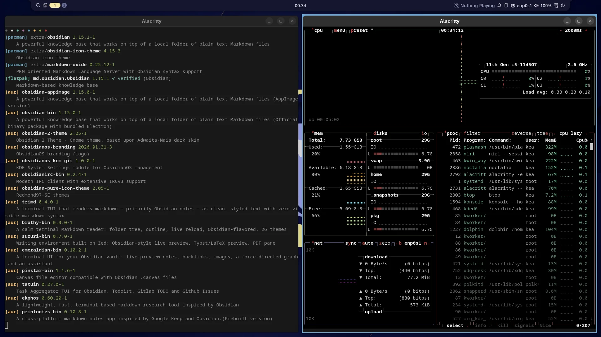
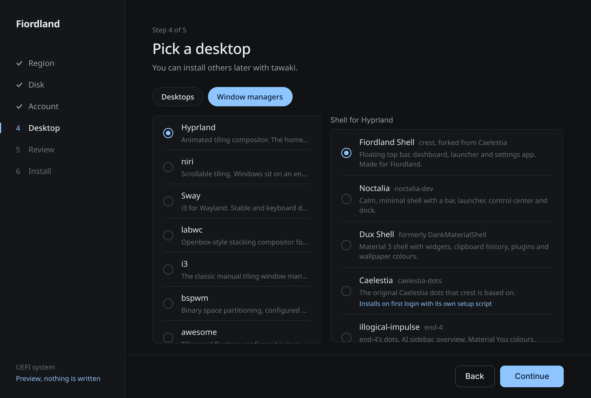

<h1 align="center">Fiordland Linux</h1>

<p align="center">Arch-based, fast and stable, with its own installer, package manager and shell.<br>
Named after the Fiordland penguin, the tawaki.</p>

<p align="center"><a href="https://fiordlandlinux.org">fiordlandlinux.org</a></p>

<p align="center"></p>

<p align="center">


</p>

<p align="center"></p>

<p align="center"><sub>Hyprland with crest · KDE Plasma · niri · the rawaru installer</sub></p>

## What's inside

| Path | What it is |
|------|------------|
| `crest/` | Fiordland's own Hyprland shell, one of the options in the installer. Top bar, dashboard, launcher, notifications, lock screen, settings. Quickshell + a C++ plugin, forked from Caelestia. |
| [tawaki](https://github.com/3cfl/tawaki) | Package manager in Rust, in its own repo. One command that picks the cleanest source: pacman, then Flathub, then AUR. |
| [rawaru](https://github.com/3cfl/rawaru) | Graphical installer, in its own repo (PySide6 + QML). Pick from 11 desktops and 13 window managers, with optional dotfiles (crest, Noctalia, Dux, Caelestia, end-4, HyDE, ML4W, JaKooLit, iNiR). Btrfs with snapper snapshots, zram, systemd-boot or GRUB, GPU driver detection, CachyOS or Arch kernel. |
| `packages/` | PKGBUILDs for everything above (tawaki and rawaru build from their tagged GitHub releases), plus `fiordland-desktop` (theme, icons, configs, defaults). |
| `iso/` | archiso profile for the live ISO. |
| `web/` | The website. |
| `tools/` | Build helpers: chroot builds, colour scheme and wallpaper generators, VM control. |

## tawaki

```
tawaki install spotify      i
tawaki remove spotify       r, rm
tawaki update               u, up
tawaki search obs           s
tawaki list                 ls
tawaki install foo --from aur
```

If the top pick is a Flatpak that would pull a big runtime you don't have yet, tawaki takes a prebuilt pacman or AUR package instead, and tells you how much it skipped. The Flathub catalogue refreshes in the background, so searches never wait on it.

Config: `~/.config/tawaki/config.toml`

```toml
priority = ["pacman", "flatpak", "aur"]
aur_helper = "auto"
flatpak_scope = "user"
flatpak_remote = "flathub"
prefer_light = true
```

## Kernel and drivers

Installs default to the [CachyOS](https://cachyos.org) kernel (`linux-cachyos`), pulled from CachyOS's baseline `[cachyos]` repo, which sits after the Arch repos so only CachyOS-only packages come from it. The stock Arch `linux` kernel stays installed as a second boot entry. Pick "Arch kernel" in the installer to skip CachyOS entirely.

The installer detects the GPU: NVIDIA Turing and newer get `nvidia-open` (plus `linux-cachyos-nvidia-open`), older NVIDIA cards use nouveau, Intel and AMD get the matching Vulkan and VA-API drivers. Multilib is enabled for Steam and Wine.

## crest

Runs with `qs -c crest`. Settings live in `~/.config/caelestia/shell.json` and in the settings app (Super + I).

Changes from Caelestia:

- Floating top bar instead of the side bar and screen frame; panels and popouts drop down from it
- Grey and baby blue scheme (`fiordland`), Inter everywhere
- Pill workspace indicator, single-line clock that opens the dashboard
- Fiordland wallpaper, no mascot artwork
- Terminal system info toggle (Settings → Apps → Terminal)

## Building

Needs an Arch-based host with `archiso`, `devtools` and `base-devel`.

```
./build.sh            build all packages and the ISO into out/
SKIP_AUR=1 ./build.sh skip the chroot builds of crest and its AUR deps
./vm.sh --share       boot the ISO in QEMU
```

Installed systems use the package repo at `https://fiordlandlinux.org/repo/x86_64`.

## Security

Report vulnerabilities privately; see [SECURITY.md](SECURITY.md). Signing key handling and backups: [docs/signing-key.md](docs/signing-key.md).

## Credits

- [Caelestia shell](https://github.com/caelestia-dots/shell) by the Caelestia contributors, which crest is forked from (GPL-3.0)
- [archiso](https://gitlab.archlinux.org/archlinux/archiso), the base of the ISO profile
- AUR maintainers of the bundled PKGBUILDs in `packages/aur/`
- Tawaki photos on the website from Wikimedia Commons, credited per photo
- Tux by Larry Ewing, Simon Budig and Garrett LeSage, made with The GIMP. Used as the temporary Fiordland mascot and logo.

## License

GPL-3.0. See [LICENSE](LICENSE).
